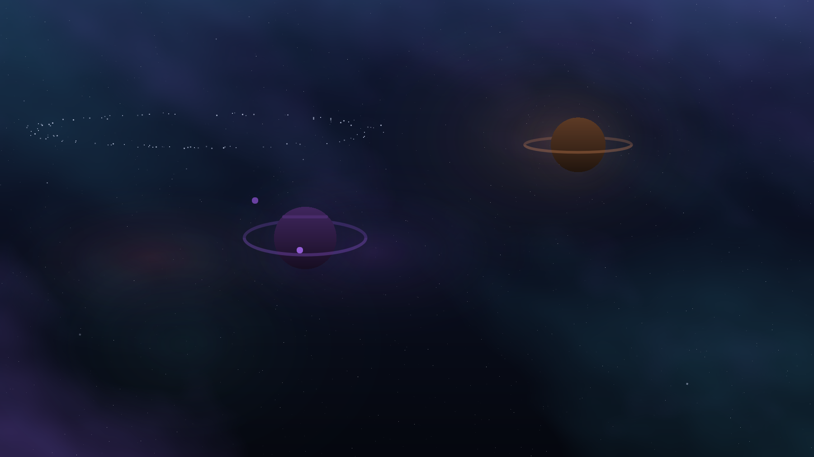

# omarchy-kumonari-sky

The sky of the [Kumonari theme](https://github.com/sterre-g/omarchy-kumonari-theme)
for the Omarchy shell: a deep field over the wallpaper that turns, breathes and
occasionally throws something across itself.



It is rolled fresh every morning: one to three worlds with their own rings,
moons and weather, two to four clouds of gas, three depths of stars turning
about a pole off the corner of the screen, a comet every ten or twenty seconds,
and now and then a distant galaxy or a belt of rubble. The layout comes from
the calendar day, and the colours come from whatever `colors.toml` the theme is
wearing.

It draws only while Kumonari is the current theme. Switch to another theme and
the sky is gone; switch back and it returns.

## Install

Needs Omarchy 4.5 or newer, and the theme it belongs to:

```sh
omarchy theme install https://github.com/sterre-g/omarchy-kumonari-theme
omarchy plugin add https://github.com/sterre-g/omarchy-kumonari-sky.git --enable
omarchy restart shell
```

The sky is a service, which the shell builds when it starts, so it appears
after the restart. Nothing is switched off to make room for it: Omarchy goes on
drawing the wallpaper, and the sky sits on the layer above it.

If you installed the sky with the theme's own `install.sh` before it moved
here, take that copy out first with `omarchy plugin remove kumonari.sky`.

## Remove

```sh
omarchy plugin remove kumonari.sky
omarchy restart shell
```

That is all of it. The plugin writes no files and changes no settings, so the
desktop is as it was before. The theme stays installed; remove it separately
with `omarchy theme remove kumonari`.

## A different sky every day

The day is the seed. [Sky.js](Sky.js) rolls the whole scene from the local
calendar date, so the sky changes at midnight and stays put until the next one,
and the day you liked comes back if you set the clock back to it.

What the roll decides: how many worlds there are and where, how big, what
colour, whether they have rings and how flat those are seen, how many clouds of
gas and where they sit, how thick the stars are, and whether tonight gets a
galaxy, a belt, or neither. Worlds are rolled with a separation check, so two of
them never touch.

Two monitors get different skies on the same night. The seed is the day mixed
with the monitor's name: one evening, two windows onto it.

`SystemClock` and not a `Timer` for the rollover. A Timer counts monotonic
time, which is the time the machine has been awake, so a laptop shut at eleven
and opened at nine would still be showing yesterday.

## Colours come from the theme

The sky reads the active theme's `colors.toml` and builds its palette out of
it: gas, planets, moons and stars are all hues the theme named. Edit
`colors.toml` and the whole sky follows. Nothing in the QML names a colour.

Hues are kept and brightness is not. Saturation and lightness are pulled into a
band a cloud can be seen in, because a palette that sits at 15% saturation would
otherwise draw gas nobody can see over a dark wallpaper. Near-duplicate hues are
dropped, a sparse palette is filled out a fifth of the hue circle apart, and a
theme with no `colors.toml` at all falls back to the shell's own colours.

## The sky stops when the theme does

An Omarchy shell plugin belongs to the desk, not to a theme: it is enabled once
and runs until somebody turns it off, and switching theme never reaches it. So
the sky asks. Omarchy writes the theme's slug to
`~/.local/state/omarchy/current/theme.name` on its way through a change, and the
sky watches that file and draws only when the answer is `kumonari`. Off means
the layer surface is destroyed rather than hidden, so a desktop wearing
something else is not paying for this at all.

It draws on `WlrLayer.Bottom`, the layer directly above the wallpaper and below
windows, with an empty input region so that clicks still reach the desktop.

## What it costs

The sky is one fragment shader. There is no item per star, and what the
processor does per frame is add one number to a uniform.

Measured on a 2560x1600 screen with nothing else on it:

| omarchy-shell | |
|---|---|
| sky drawing | 2.0% of a core |
| a window over the desktop | 0.2% of a core |

Frames are rationed by speed: nothing up there moves faster than about eight
pixels a second, so it draws twelve frames a second, and a meteor gets the
card's own rate for the second it takes to cross. `idle` at the top of
[Field.qml](Field.qml) is the rate if you want a different one. A single window
over a monitor stops that monitor's clock.

With animations turned off (`omarchy toggle animations`) the sky holds still on
the frame it is on. A locked screen has no signal a plugin can read, so the
sky's clock keeps counting behind the lock screen.

## Layout

```
manifest.json        id kumonari.sky, a service
Sky.js               all the arithmetic: palette, day, plan
Sky.qml              the Wayland half: layer surface, theme gate, wall clock
Field.qml            the plan as uniforms, and the clock
sky.frag             everything that actually draws
sky.frag.qsb         the same, compiled, and committed
preview.qml          Field.qml, rendered to PNGs
bin/build-shaders.sh compile sky.frag to the .qsb the desktop loads
bin/preview.sh       render days to PNGs, any theme, without wearing it
test/                the arithmetic, under node
```

`sky.frag.qsb` is committed because nothing on the desktop this installs onto
has Qt's shader tools on it. Rebuild it with `bin/build-shaders.sh` after
changing the `.frag` and commit both halves. That script also checks that the
bundle has a GLSL ES shader in it: Quickshell comes up on OpenGL ES, and a
bundle built for desktop GL alone draws nothing while saying so only in the
journal.

## Development

```sh
./run-tests          # node, omarchy plugin validate, Qt 6 qmllint
./dev-sync           # the working tree into ~/.config/omarchy/plugins/kumonari.sky
omarchy restart shell
bin/preview.sh       # the next seven days as PNGs, without waiting for them
bin/preview.sh --theme gruvbox --days 3
```

[test/sky.test.js](test/sky.test.js) covers the colour parsing and lifting, the
day seed and the layout roll without a compositor in the room. `bin/preview.sh`
needs the desktop it is run from, because Qt's `offscreen` platform draws a
`ShaderEffect` as nothing at all; the window it opens shows for as long as the
render takes.

A service is built once when the shell starts, so after `./dev-sync` the shell
says "Local plugin changed, reloading" and goes on running the code it started
with until `omarchy restart shell`.

## License

MIT, see [LICENSE](LICENSE).
